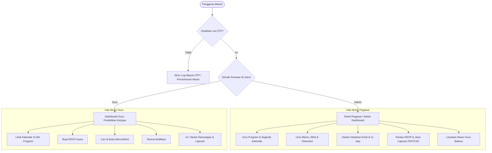
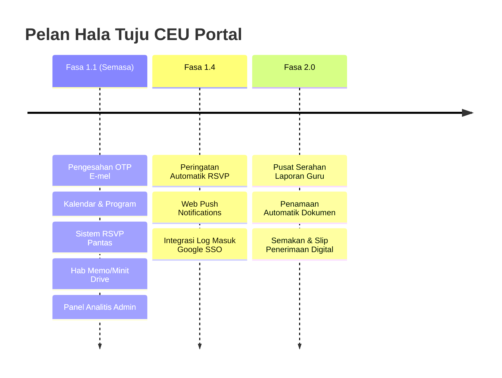

# Product Requirements Document (PRD) Final
## **CEU Portal — Unit Pendidikan Kerjaya, Jabatan Sekolah-Sekolah**
**Versi:** 1.1 (dengan Pelan Hala Tuju v1.4 & v2.0)  
**Tarikh:** 1 November 2026  
**Status:** Diluluskan & Siap untuk Prototaip UI/UX / Pembangunan  
**Penyedia:** AI Solution Architect & @ND  

---

## 1. Ringkasan Eksekutif (Executive Summary)

**CEU Portal** ialah aplikasi web progresif (PWA / Web App) berprestasi tinggi yang dibangunkan khusus untuk **Unit Pendidikan Kerjaya (UPK), Jabatan Sekolah-Sekolah**. Aplikasi ini bertindak sebagai hab komunikasi rasmi, pengurusan aktiviti, kalendar interaktif, arkib memo/minit mesyuarat, sistem pengesahan kehadiran (RSVP), dan pusat penyerahan dokumen antara Pegawai Unit dan Guru-Guru Pendidikan Kerjaya di semua sekolah seluruh daerah.

Dibina di atas infrastruktur tanpa kos pelayan (serverless) **Google Workspace (Google Apps Script & Google Sheets)**, sistem ini menggabungkan seni bina *Single Page Application (SPA)* yang responsif, pantas, selamat dengan pengesahan emel OTP 6-digit, serta mesra telefon pintar (*mobile-first*) dengan identiti visual rasmi berpandukan logo UPK.

---

## 2. Objektif Produk & Nilai Strategik (Product Goals & Business Values)

| No | Sasaran Objektif | Nilai / Metrik Kejayaan |
|:---|:---|:---|
| 1 | **Sentralisasi Maklumat & Dokumen** | Menghapuskan isu memo/minit mesyuarat tercicir dalam WhatsApp; 100% dokumen rasmi boleh dicapai melalui hab terpusat berasaskan pautan Google Drive. |
| 2 | **Penyegerakan Kalendar Program** | Memastikan semua guru kerjaya peka terhadap program mingguan, bulanan, dan tahunan dengan integrasi Google Calendar automatik. |
| 3 | **Automasi Kehadiran & Pengesahan (RSVP)** | Mengurangkan masa manual susulan kehadiran; status kehadiran (Hadir/Tidak Hadir/Mewakilkan) dijana secara masa nyata (*real-time*). |
| 4 | **Pengalaman Pengguna Mesra Telefon (Mobile-First)** | Membolehkan guru mengurus hal ehwal kerjaya terus daripada telefon pintar dengan *bottom navigation bar*, muat turun pantas, dan antara muka pantas tanpa lag. |
| 5 | **Keselamatan & Kawalan Akses Rasmi** | Log masuk tanpa kata laluan (*passwordless*) melalui OTP e-mel rasmi kerajaan/kementerian (.moe.bn / .gov.bn / .edu.bn) bagi menjamin kesahihan pengguna. |

---

## 3. Pengguna Sasaran & Matriks Hak Akses (RBAC)

Sistem menggunakan model kawalan capaian berasaskan peranan (*Role-Based Access Control*):



### Matriks Peranan & Keupayaan

| Ciri / Modul | Guru Pendidikan Kerjaya | Pegawai Unit (Admin) |
|:---|:---:|:---:|
| **Log Masuk OTP E-mel Rasmi** | ✅ Ya | ✅ Ya |
| **Mohon Akaun Baharu** | ✅ Ya (Status: Menunggu) | ❌ (Diurus manual/terus) |
| **Lihat Dashboard & Petunjuk Utama** | ✅ Ya | ✅ Ya |
| **Lihat & Tapis Kalendar / Program** | ✅ Ya | ✅ Ya |
| **Segerak ke Google Calendar Peribadi/Unit** | ❌ (Hanya import/lihat) | ✅ Penuh (Dwi-hala via API) |
| **Pengesahan Kehadiran (RSVP)** | ✅ Ya (Hantar & Kemas kini) | ✅ Lihat Semua + Analitis |
| **Baca Memo, Minit & Dokumen Tahunan** | ✅ Ya (Buka pautan Drive) | ✅ Tambah/Sunting/Padam |
| **Terima Notifikasi (In-App & E-mel)** | ✅ Ya | ✅ Ya |
| **Cipta & Siar Notifikasi Hebahan** | ❌ Tiada | ✅ Ya (BCC Kelompok) |
| **Muat Turun Laporan CSV / Rumusan PDF** | ❌ Tiada | ✅ Ya |
| **Kelulusan Pengguna & Urus Direktori** | ❌ Tiada | ✅ Ya |
| **Muat Naik Laporan/Rancangan (Fasa v2)** | ✅ Ya (Borang serahan fail) | ✅ Semak, Lulus & Catat Ulasan |

---

## 4. Seni Bina Data & Integrasi Ekosistem Google Workspace

### A. Struktur Pangkalan Data (Google Sheets)

Database menggunakan satu fail Google Spreadsheet utama dengan 11 helaian (Sheets) piawai (v1.1) dan 1 helaian tambahan (v2.0):

| Helaian | Medan / Lajur Utama | Deskripsi & Fungsi |
|:---|:---|:---|
| **`Program`** | `ID`, `Nama`, `Kategori`, `Tarikh`, `TarikhTamat`, `Masa`, `Lokasi`, `Sasaran`, `Keterangan`, `Status` | Rekod induk program Unit (Mingguan, Bulanan, Tahunan). Status: *Aktif, Selesai, Dibatalkan*. |
| **`Kalendar`** | `ID`, `Tajuk`, `Jenis`, `Tarikh`, `MasaMula`, `MasaTamat`, `Lokasi`, `Keterangan`, `Sasaran`, `RSVP`, `CalEventId` | Rekod acara terperinci dan pemetaan ID Google Calendar (`CalEventId`). |
| **`RSVP`** | `ID`, `AcaraID`, `Email`, `Nama`, `Sekolah`, `Status`, `Catatan`, `Masa` | Status respon guru (*Hadir*, *Tidak Hadir*, *Mewakilkan*). |
| **`Memo_Minit`** | `ID`, `Jenis`, `Tajuk`, `NoRujukan`, `Tarikh`, `Kategori`, `Pautan`, `Ringkasan` | Arkib rasmi memo dan minit mesyuarat berserta pautan Google Drive. |
| **`Dokumen`** | `ID`, `Jenis`, `Tajuk`, `Tahun`, `Format`, `Pautan` | Rujukan dokumen strategik unit (Rancangan/Laporan Tahunan UPK). |
| **`Sekolah`** | `ID`, `Nama`, `Kod`, `Daerah`, `Kluster`, `Status` | Direktori maklumat sekolah kebangsaan/menengah. |
| **`Guru`** | `ID`, `Nama`, `Jawatan`, `Email`, `Sekolah`, `Daerah`, `Status` | Direktori perhubungan Guru Kaunseling/Kerjaya. |
| **`Users`** | `Email`, `Nama`, `Peranan`, `Sekolah`, `Daerah`, `Status` | Kawalan pengesahan log masuk (*Admin* atau *Guru*). |
| **`Permohonan`** | `ID`, `Nama`, `Email`, `Sekolah`, `Jawatan`, `Masa`, `Status` | Pengurusan pendaftaran guru baharu (*Menunggu, Diluluskan, Ditolak*). |
| **`Notifikasi`** | `ID`, `Tajuk`, `Kategori`, `Keutamaan`, `Mesej`, `SasaranJenis`, `SasaranData`, `Saluran`, `Penghantar`, `Masa`, `Ref` | Arkib mesej hebahan (Biasa/Segera) berserta sasaran penerima. |
| **`Log`** | `Masa`, `Email`, `Tindakan`, `Butiran` | Jejak audit keselamatan bagi sebarang transaksi dan perubahan data. |
| **`Penyerahan_Laporan`** *(Fasa v2)* | `ID_Serahan`, `Kod_Sekolah`, `Nama_Sekolah`, `Nama_Guru`, `Jenis_Dokumen`, `Tahun`, `Tarikh_Hantar`, `Pautan_Fail`, `Status_Semakan`, `Catatan_Pegawai` | Pengurusan fail digital serahan rancangan dan laporan tahunan daripada sekolah. |

### B. Penyimpanan Berkas (Google Drive)
- **Folder Induk:** `CEU_Portal_Files`
  - Subfolder `Memo_dan_Minit`: Disunting oleh Pegawai; perkongsian mod *Viewer* untuk guru.
  - Subfolder `Dokumen_Tahunan`: Dokumen rujukan rasmi unit.
  - Subfolder *(Fasa v2)* `Rancangan_Tahunan` & `Laporan_Tahunan`: Tempat fail serahan guru disimpan secara automatik dengan format nama: `[KodSekolah]_[JenisDokumen]_[Tahun].pdf`.

### C. Integrasi Ekosistem Google
1. **Google Calendar API:** Sinkronisasi dwi-hala acara portal ke Google Calendar rasmi unit UPK.
2. **GmailApp / MailApp:** Penghantaran kod OTP 6-digit serta hebahan notifikasi rasmi secara kelompok BCC (50 penerima/kelompok bagi mematuhi kuota harian).
3. **Google Drive Service:** Penjanaan pautan paparan selamat tanpa mendedahkan kebenaran suntingan kepada pengguna umum.

---

## 5. Keperluan Fungsian (Functional Requirements)

### Modul 1: Pengesahan & Pengurusan Pengguna (Authentication & Onboarding)
- **Log Masuk OTP:** Guru/Pegawai memasukkan alamat e-mel rasmi (.moe.bn, .gov.bn, .edu.bn). Sistem menghantar OTP 6-digit (tempoh sah 5 minit).
- **Sesi Pengguna:** Token sesi disulitkan dengan HMAC dan disimpan selamat pada storan tempatan (*Local Storage*) selama 30 hari.
- **Pendaftaran Akses Baharu:** Borang mohon capaian sekiranya e-mel belum tersenarai dalam pangkalan data `Users`. Notifikasi dihantar ke Pegawai untuk kelulusan 1-klik.

### Modul 2: Dashboard Guru & RSVP Pintar (Home & Smart RSVP)
- **Ringkasan Pantas:** Banner program minggu ini, acara terdekat, dan bilangan RSVP yang belum dijawab.
- **Kad Tindakan RSVP Pantas:** Tiga acara terdekat dipaparkan dengan pilihan mudah (*Hadir*, *Tidak Hadir*, *Mewakilkan Guru Lain* + ruang catatan).
- **Sekatan Automatik:** Butang RSVP dikunci secara automatik selepas tarikh acara tamat.

### Modul 3: Kalendar Interaktif & Jadual Aktiviti
- **Paparan Fleksibel:** Pilihan paparan Kalendar Bulanan, Mingguan, dan Senarai Agenda.
- **Pengekodan Warna Acara:** Warna acara dipadankan secara automatik mengikut jenis (cth: Mesyuarat, Bengkel, Taklimat, Lawatan).
- **Carian & Penapis:** Menapis program mengikut kategori atau status (Aktif/Selesai).

### Modul 4: Hab Dokumen, Memo & Minit
- **Pencarian Komprehensif:** Carian teks pantas mengikut No Rujukan, Tajuk, Kategori, atau Tahun.
- **Akses Dokumen:** Butang "Buka Dokumen" membuka fail terus daripada Google Drive dalam tab baharu.

### Modul 5: Hab Notifikasi & Komunikasi
- **Peti Notifikasi Dalam Aplikasi (In-App Bell):** Ikon loceng dengan lencana bilangan belum dibaca.
- **Penyiaran Berbilang Saluran:** Pegawai boleh menghantar makluman segera melalui portal dan e-mel rasmi serentak mengikut sasaran (Semua / Sekolah Tertentu / Guru Khusus).

### Modul 6: Panel Pentadbir & Analitis (Admin Command Center)
- **Statistik & Carta Interaktif:** Carta visual kadar peratusan RSVP mengikut program dan kadar keaktifan daerah/sekolah.
- **Eksport Data:** Butang 1-klik untuk mengeksport rekod kehadiran ke format CSV.
- **Laporan Ringkasan PDF:** Keupayaan menjana lembaran rumusan kehadiran dalam format PDF terus ke e-mel rasmi UPK.

---

## 6. Spesifikasi Antaramuka & Identiti Visual (UI/UX Design)

### A. Palet Warna Rasmi (Diadaptasi daripada Logo UPK)

Antaramuka CEU Portal menggunakan bahasa visual beridentitikan jata rasmi **Unit Pendidikan Kerjaya (UPK), Jabatan Sekolah-Sekolah**:

| Peranan Warna | Nilai HEX | Penggunaan pada Antaramuka |
|:---|:---:|:---|
| **Primary Blue (Lautan UPK)** | `#1976D2` / `#167DB2` | Warna utama bar navigasi, butang utama, tajuk kad, dan lencana aktif. |
| **Secondary Sky Blue (Bulatan Luar)** | `#81C2E6` / `#E3F2FD` | Warna latar kad sorotan, penunjuk tab aktif, dan aksen latar lembut. |
| **Accent Gold (Emas UPK)** | `#C59B27` / `#D4AF37` | Lencana status penting, ikon sorotan VIP, bintang, dan penunjuk RSVP Menunggu. |
| **Accent Red (Aksen Garisan Jata)** | `#E53935` | Tanda notifikasi baharu (badge loceng), butang amaran/batal, dan penanda "Segera". |
| **Dark Navy / Slate (Teks Rasmi)** | `#0D2B45` / `#1E293B` | Tipografi tajuk, badan teks bertaraf kebolehbacaan tinggi (WCAG AAA). |
| **Surface & Background** | `#F8FAFC` & `#FFFFFF` | Latar belakang aplikasi yang bersih, kemas, dan tidak meletihkan mata. |

### B. Prinsip Susun Atur Mobile-First & Navigasi

```
+------------------------------------------+
|  [Logo UPK] CEU PORTAL        (🔔 2) (👤)| -> Bar Atas Padat
+------------------------------------------+
|  Selamat Kembali, Cikgu Ahmad!           |
|  SMK Bandar Seri Begawan                 |
|                                          |
|  +------------------------------------+  |
|  | 📌 PROGRAM MINGGU INI (2 Acara)    |  | -> Hero Status Card
|  +------------------------------------+  |
|                                          |
|  ACARA AKAN DATANG                       |
|  +------------------------------------+  |
|  | 📅 Bengkel Kerjaya Siri 1/2026     |  |
|  | 🕒 10 Nov 2026 | 08:30 Pagi        |  |
|  | Status RSVP: [ Menunggu Respon ]   |  |
|  | [ ✅ Hadir ]  [ ❌ Tidak ]  [ 🔄 ]  |  | -> Butang Respon Cepat
|  +------------------------------------+  |
|                                          |
|  MEMO & MINIT TERKINI                    |
|  📄 Memo Bil. 04/2026 - Taklimat Biasiswa |
|  📄 Minit Mesyuarat Penyelarasan Bil 2   |
+------------------------------------------+
|  ( 🏠 )    ( 📅 )    ( 📄 )    ( ⚙️ )     | -> Bottom Navigation Bar
|  Utama   Kalendar   Dokumen    Admin     |
+------------------------------------------+
```

- **Bottom Navigation Bar:** Memudahkan operasi sebelah tangan (*one-handed thumb navigation*) pada telefon pintar:
  1. **Utama (Home):** Dashboard, penunjuk segera, & respon pantas.
  2. **Kalendar:** Paparan kalendar visual & jadual program.
  3. **Dokumen:** Carian memo, minit mesyuarat, dan fail tahunan.
  4. **Pemberitahuan:** Arkib mesej hebahan.
  5. **Admin:** Ditampilkan khusus untuk pegawai berstatus Admin.
- **Elemen Sentuh Mesra Jari:** Kawasan sentuhan butang bersaiz minimum 48x48 piksel.
- **Maklum Balas Antaramuka Pantas (Optimistic UI):** Apabila guru menekan butang Hadir/Tidak Hadir, status pada skrin berubah serta-merta tanpa menunggu masa pusingan pelayan selesai.

---

## 7. Batasan Teknikal & Strategi Mitigasi Kuota GAS

| Kekangan Google Apps Script | Risiko Berpotensi | Strategi Mitigasi Terbukti |
|:---|:---|:---|
| **Had Masa Eksekusi (6 Minit)** | Pemuatan data berat atau penghantaran e-mel pukal terhenti di separuh jalan. | Menggunakan corong muat data kelompok tunggal (`apiBoot`), memproses rekod dalam memori (*in-memory filtering*), dan mengasingkan tugas berat. |
| **Kuota Penghantaran E-mel Harian** | Akaun biasa terhad 100 e-mel/hari; akaun Workspace terhad 1,500/hari. | Menggunakan teknik **BCC 50 penerima per e-mel**, memotong penggunaan kuota daripada 200 panggilan e-mel kepada 4 panggilan sahaja. |
| **Kesesakan Kunci Baris (Lock Contention)** | Ramai guru menekan butang RSVP pada masa yang serentak boleh mencetuskan ralat konkurensi Sheets. | Melaksanakan `LockService.getScriptLock()` dengan masa tunggu maksimum 10 saat dan struktur penulisan kelompok (`appendRow` / `setValues`). |
| **Latensi Panggilan Pelayan (Round-Trip Time)** | Pengalaman pengguna lambat jika setiap klik memanggil `google.script.run`. | Seni bina **Single Page Application (SPA)**: semua aset disimpan di memori klien, navigasi halaman berlaku serta-merta, dan penyegaran data latar belakang berjalan setiap 2 minit. |
| **Penyimpanan Berkas Besar (v2)** | Bebanan memori pelayan semasa menerima fail PDF serahan guru. | Hadkan saiz maksimum fail kepada 5 MB, format PDF sahaja, dan aliran muat naik diproses terus ke folder sasaran Google Drive. |

---

## 8. Pelan Hala Tuju Pembangunan & Deployment



### Konfigurasi Deployment (GAS Web App)
- **Execute as:** `Me` (Akaun Pentadbir UPK)
- **Who has access:** `Anyone` (Keselamatan dikawal sepenuhnya oleh sistem OTP e-mel rasmi dan token sesi HMAC di pelayan).
- **Format URL:** Bersih tanpa parameter bilah URL (`?page=`), sedia untuk dibenamkan selamat ke dalam iFrame Google Sites atau Blogger rasmi jabatan.
- **Pengurusan Rahsia:** Semua kunci sulit (`SESSION_SECRET`, ID Spreadsheet, ID Kalendar) disimpan dalam `Script Properties` (sifar pendedahan kod sumber).

---

🎨 **Tahapan Khusus: Penentuan Visual UI/UX**
1. Unggah Referensi: Silakan unggah referensi tangkapan layar, warna, dan gaya antarmuka yang diinginkan.
2. Jika Belum Ada Referensi Visual:
   - Salin seluruh teks dokumen PRD Final di atas.
   - Buka Google Stitch, lalu tempelkan teks PRD ke dalamnya.
   - Unduh hasil pratinjau desain visual yang dihasilkan oleh Google Stitch.
   - Unggah gambar hasil desain tersebut ke percakapan ini untuk diimplementasikan ke dalam kode HTML/CSS.
